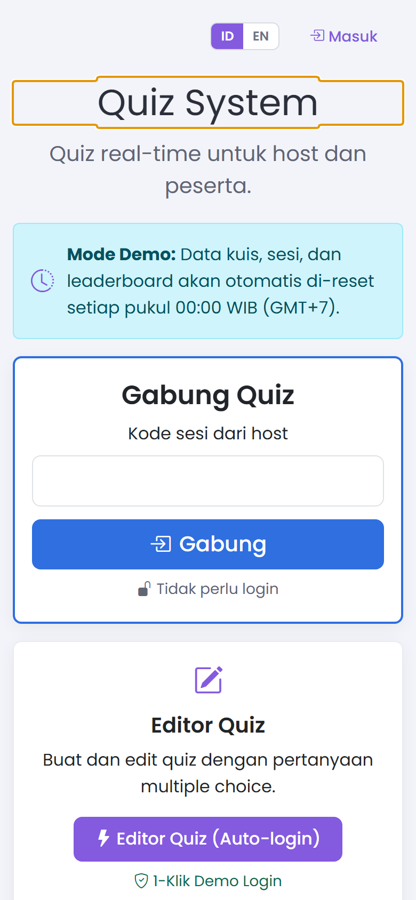
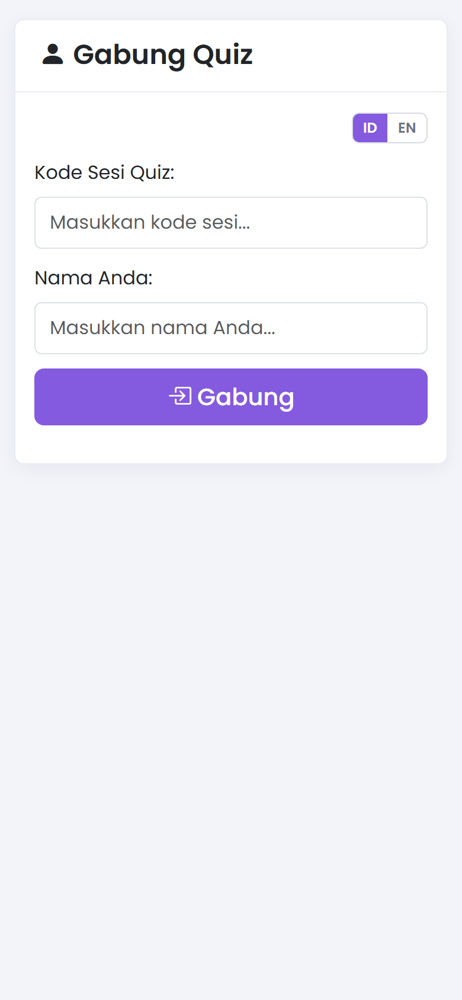
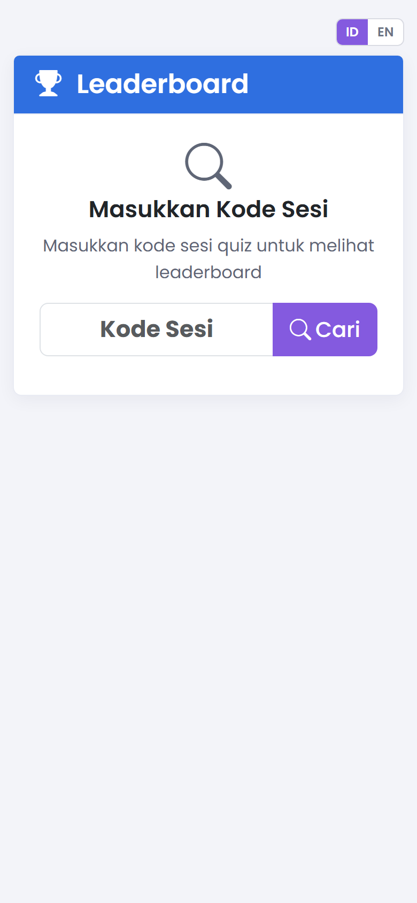
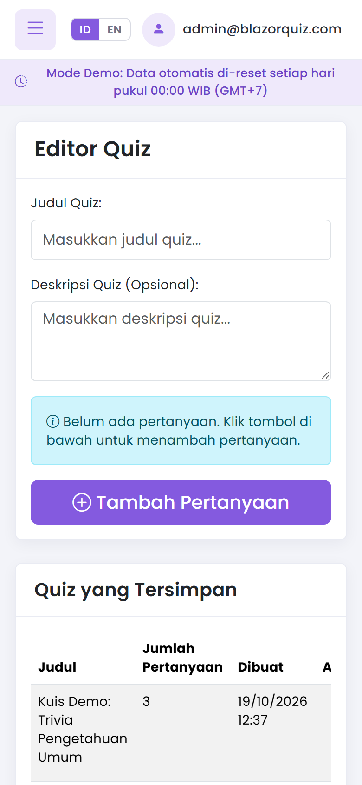
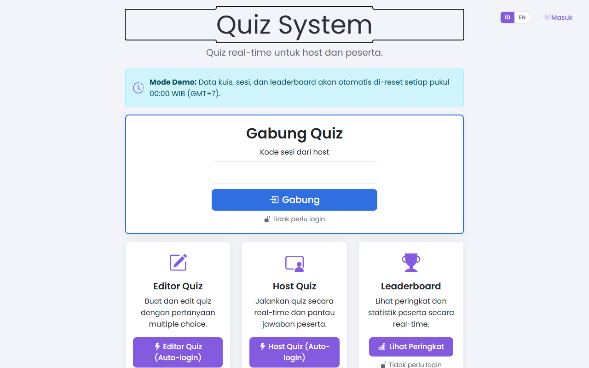
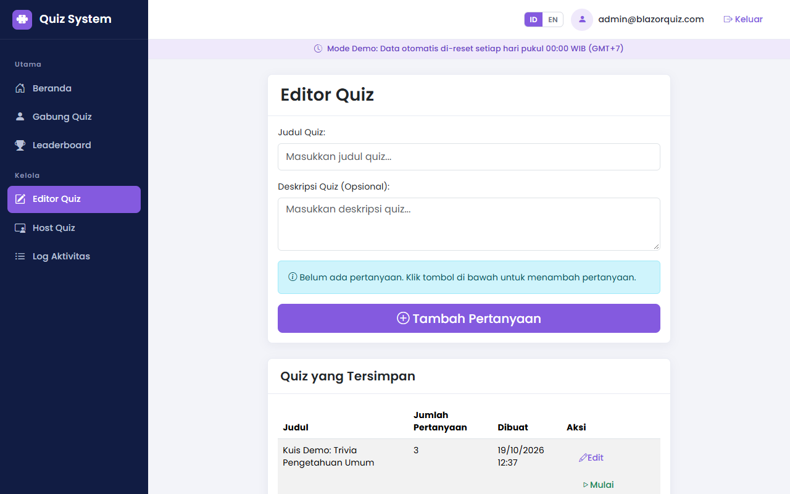
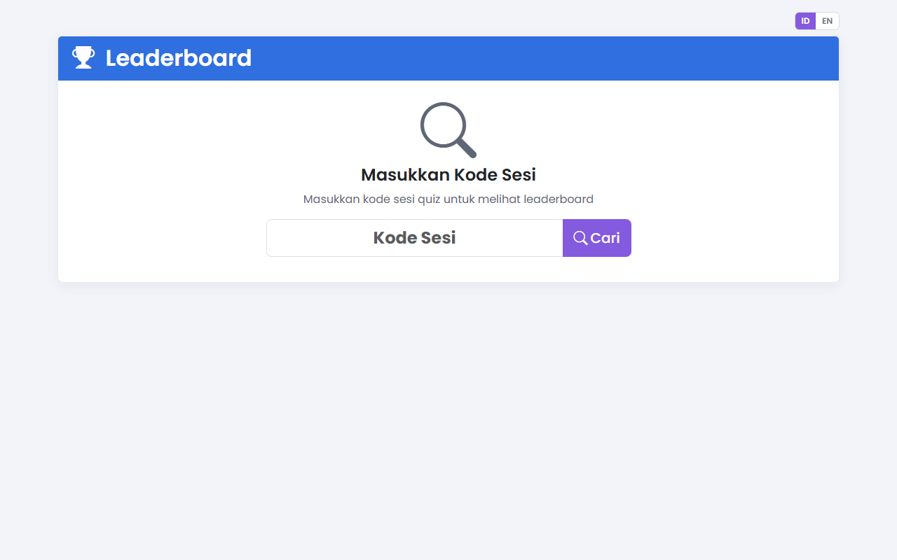
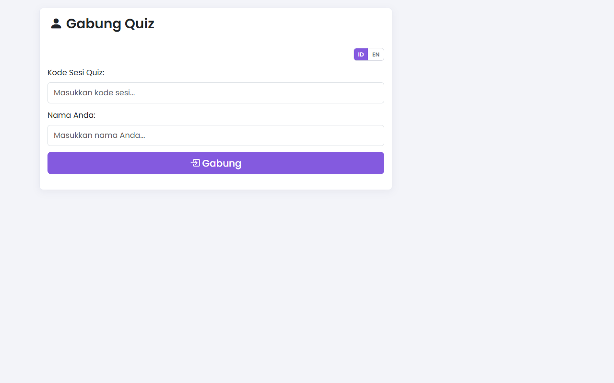

# BlazorQuiz

**Bahasa Indonesia** | [English](README.md)

Sistem kuis real-time bergaya Kahoot yang bisa Anda jalankan sendiri. Host membuat dan menjalankan sesi, peserta bergabung dari ponsel dengan kode sesi, dan papan peringkat diperbarui langsung.


[](https://blazorquiz.bukutamudigital.com/)

> **Live Demo:** [https://blazorquiz.bukutamudigital.com/](https://blazorquiz.bukutamudigital.com/) (Tersedia fitur 1-klik demo auto-login untuk Host dan Editor Quiz)

## Tangkapan Layar (Screenshots)

### Tampilan Ponsel (Mobile View)

| Beranda & Gabung | Layar Peserta | Leaderboard | Editor Quiz |
|:---:|:---:|:---:|:---:|
|  |  |  |  |

<details>
<summary><strong>Tampilan Desktop</strong> (klik untuk membuka)</summary>

| Beranda / Gabung Quiz | Editor Quiz & Dashboard |
|:---:|:---:|
|  |  |

| Leaderboard | Layar Gabung Peserta |
|:---:|:---:|
|  |  |

</details>

## Fitur

- Sesi kuis real-time: host mengendalikan soal, peserta menjawab dari ponsel
- Papan peringkat langsung, per soal dan keseluruhan
- Editor kuis dan soal pilihan ganda
- Akun host lengkap: peran Admin/User, autentikasi dua faktor (2FA), kode pemulihan, login eksternal
- Antarmuka dua bahasa: Indonesia dan English
- Log aktivitas
- Satu aplikasi .NET, tanpa Redis atau layanan pencarian terpisah

## Teknologi

Blazor Server (.NET 10), SignalR, Entity Framework Core, ASP.NET Core Identity, MudBlazor, SQL Server.

## Menjalankan secara lokal

Prasyarat: [.NET SDK 10](https://dotnet.microsoft.com/download) dan SQL Server (LocalDB atau server biasa).

```bash
git clone <url-repo-ini>
cd BlazorQuiz
```

### 1. Buat `appsettings.json`

File `BlazorQuiz/appsettings.json` tidak disertakan di repo (di-ignore agar tidak ada konfigurasi lokal yang ikut ter-commit). Buat sendiri dengan isi berikut:

```json
{
  "ConnectionStrings": {
    "DefaultConnection": ""
  },
  "Logging": {
    "LogLevel": {
      "Default": "Information",
      "Microsoft.AspNetCore": "Warning",
      "Microsoft.EntityFrameworkCore": "Warning"
    }
  },
  "AllowedHosts": "*"
}
```

Biarkan `DefaultConnection` kosong. Isi lewat user-secrets (langkah 2) atau variabel lingkungan `ConnectionStrings__DefaultConnection`, jangan ditulis di file ini.

### 2. Atur connection string

```bash
cd BlazorQuiz
dotnet user-secrets set "ConnectionStrings:DefaultConnection" "<connection-string-sql-server-anda>"
```

### 3. Terapkan migrasi database

Migrasi tidak dijalankan otomatis saat aplikasi mulai. Jalankan sekali (butuh `dotnet-ef`: `dotnet tool install --global dotnet-ef`):

```bash
dotnet ef database update
```

### 4. Jalankan

```bash
dotnet run
```

Di mode Development, akun bawaan dibuat otomatis. Lihat [akun bawaan](BlazorQuiz/README-DefaultUsers.md) (Indonesia dan English).

## Deploy ke IIS atau hosting ASP.NET

Panduan ini untuk Windows Server dengan IIS, atau hosting ASP.NET berbasis IIS seperti MonsterASP.NET.

> **Transparansi:** saya tidak punya afiliasi dengan penyedia hosting mana pun. MonsterASP.NET hanya contoh hosting ASP.NET yang bisa dipakai, bukan rekomendasi berbayar, dan README ini tidak berisi link afiliasi. Pilih penyedia sesuai kebutuhan dan anggaran Anda.

### Persyaratan server

- Mendukung **.NET 10** (ASP.NET Core Hosting Bundle terpasang di IIS, atau runtime .NET 10 disediakan hosting). Cek dulu ke penyedia hosting Anda.
- Database **SQL Server** (satu database kosong dan connection string-nya).
- **WebSocket aktif** di IIS atau paket hosting. Blazor Server dan SignalR membutuhkannya agar kuis real-time berjalan.

### Langkah

1. Publikasikan aplikasi:

   ```bash
   dotnet publish BlazorQuiz/BlazorQuiz.csproj -c Release -o ./publish
   ```

2. Terapkan migrasi ke database server dari komputer Anda:

   ```bash
   dotnet ef database update --project BlazorQuiz --connection "<connection-string-server>"
   ```

   Alternatifnya, buat skrip SQL lalu jalankan lewat panel database hosting:

   ```bash
   dotnet ef migrations script --idempotent --project BlazorQuiz -o migrate.sql
   ```

3. Unggah isi folder `publish` ke folder situs di server (FTP, Web Deploy, atau file manager hosting). Berkas `web.config` dibuat otomatis oleh `dotnet publish`.

4. Di server, buat `appsettings.Production.json` di samping `BlazorQuiz.dll`. File ini hanya ada di server dan tidak dimasukkan ke git:

   ```json
   {
     "ConnectionStrings": {
       "DefaultConnection": "<connection-string-server>"
     },
     "Seed": {
       "AdminEmail": "admin@contoh.id",
       "AdminPassword": "<password-kuat-anda>"
     }
   }
   ```

   Jika hosting Anda menyediakan environment variable, bisa juga memakai `ConnectionStrings__DefaultConnection`, `Seed__AdminEmail`, dan `Seed__AdminPassword`. `Seed__UserEmail` dan `Seed__UserPassword` bersifat opsional.

5. Pastikan WebSocket aktif, jalankan situs, lalu login sebagai admin.

### Catatan produksi

- Di luar Development **tidak ada akun yang dibuat** kecuali `Seed` diisi. Akun bawaan Development tidak aktif di produksi.
- Setelah login pertama, ganti password admin lewat halaman akun, lalu hapus `Seed:AdminPassword` dari file konfigurasi server.
- Gunakan HTTPS. Aplikasi sudah mengaktifkan HSTS dan pengalihan HTTPS di luar Development.
- Jangan pernah meng-commit connection string atau password ke repo.

## Struktur proyek

| Folder | Isi |
|---|---|
| `BlazorQuiz/Components` | Halaman, layout, dan komponen Blazor (termasuk akun/Identity) |
| `BlazorQuiz/Services` | Logika kuis, event bus, log aktivitas, zona waktu, lokalisasi |
| `BlazorQuiz/Data` | `DbContext`, seeder, dan migrasi EF Core |
| `BlazorQuiz/Models` | Entitas dan DTO |

## Dibuat dengan bantuan AI

Proyek ini dibangun dengan bantuan Claude (Anthropic) dan dikelola serta direview oleh pemiliknya. Folder `.agents/` berisi aturan yang dipakai selama pengembangan.

## Status

Proyek masih berkembang. Belum tersedia: tes otomatis, CI, Docker, import soal dari Excel. Masukan dan kontribusi diterima lewat issue.

## Lisensi

[MIT](LICENSE) © 2026 Robby Gunawan Sutanto
