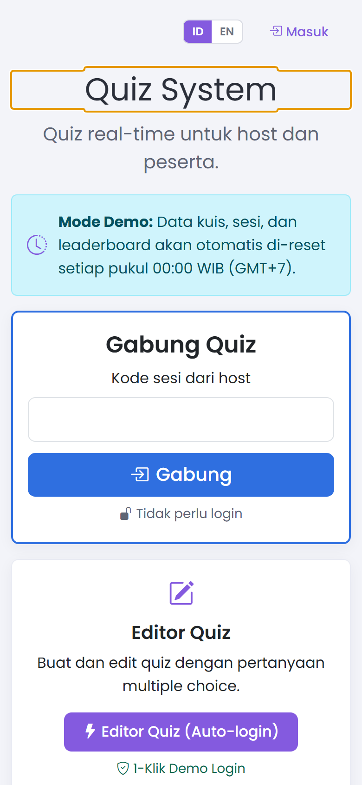
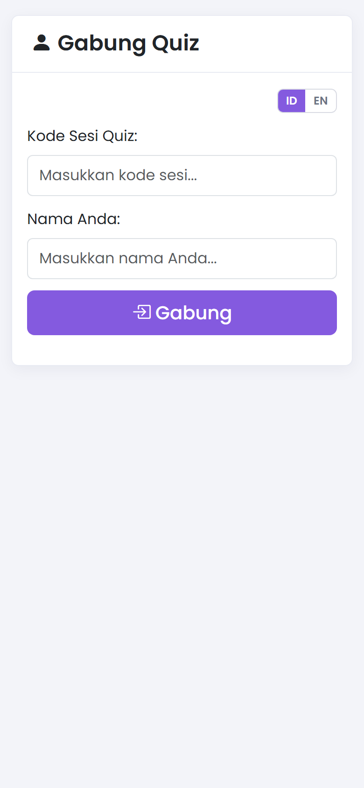
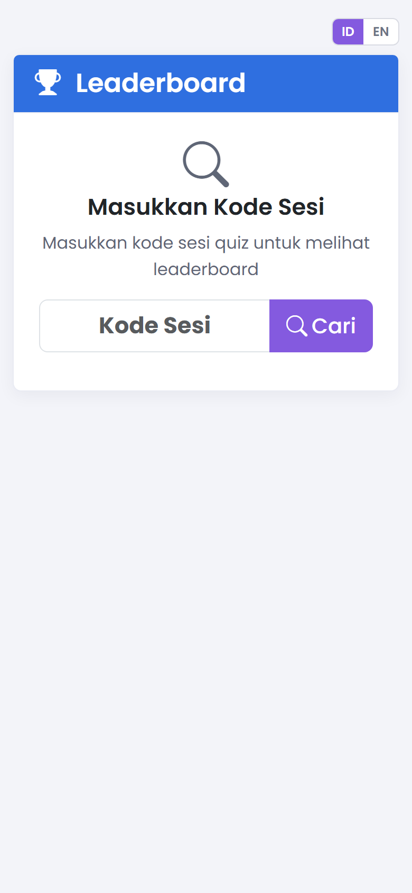
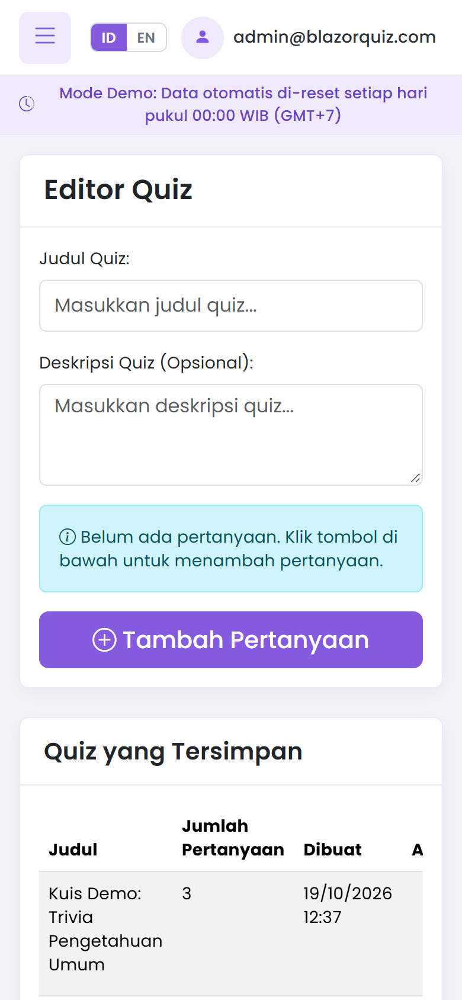
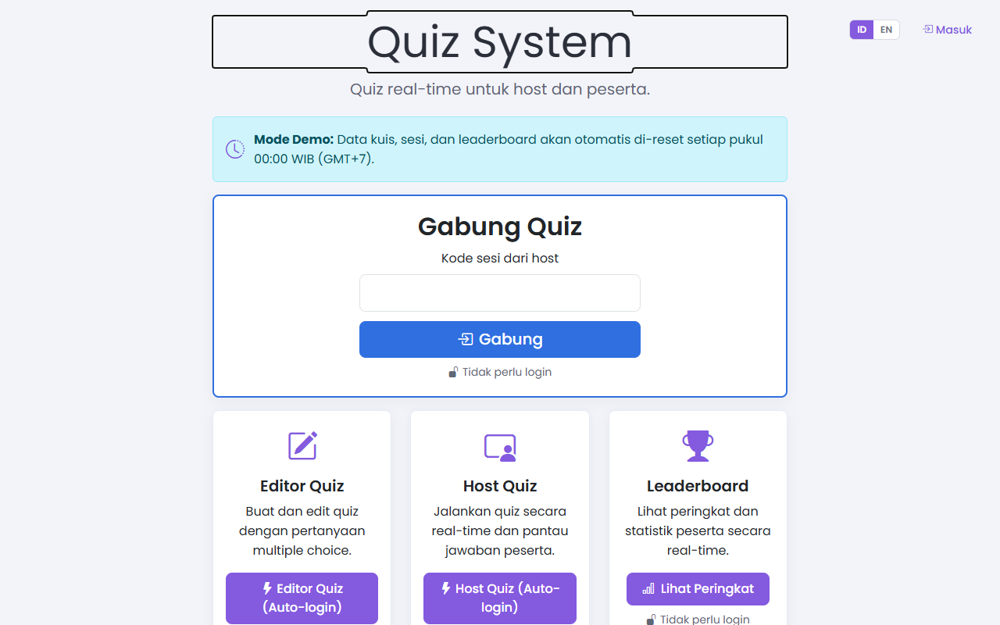
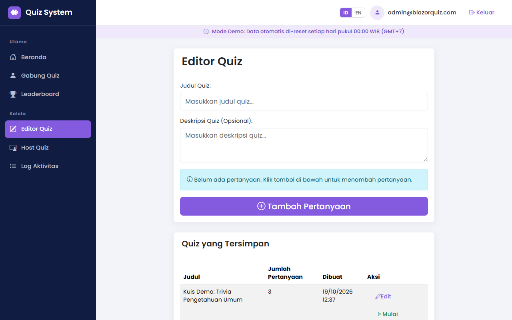
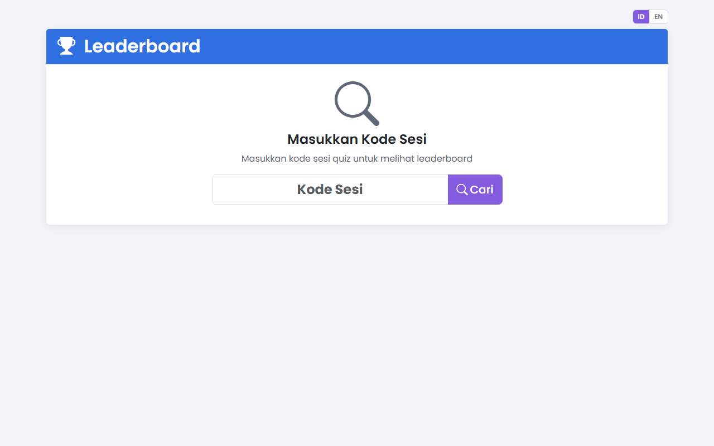
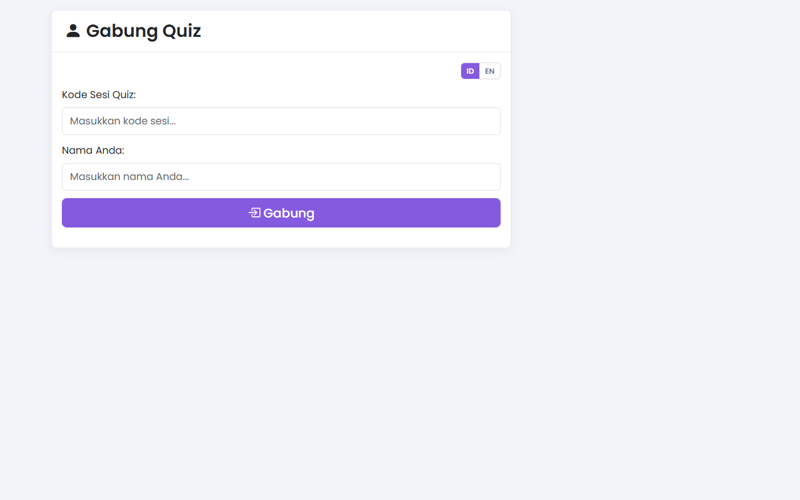

# BlazorQuiz

[Bahasa Indonesia](README.id.md) | **English**

A self-hosted, Kahoot-style real-time quiz system. The host creates and runs a session, participants join from their phones with a session code, and the leaderboard updates live.


[](https://blazorquiz.bukutamudigital.com/)

> **Live Demo:** [https://blazorquiz.bukutamudigital.com/](https://blazorquiz.bukutamudigital.com/) (Includes 1-click demo auto-login for Host and Quiz Editor)

## ⚠️ Demo source code: read before going live

This source code is built for a **public demo**, not for a real production system. The demo shortcuts below are intentional, and **must be fixed before you publish your own copy or run it live**:

1. **`/auto-login` signs anyone in as admin.** The endpoint is anonymous and has no environment check (`BlazorQuiz/Program.cs`). It also creates an admin with the default password `Admin123!` if none exists. Restrict it to Development, or behind a config flag that is off by default, and remove the default password.
2. **A daily job deletes all data.** `DailyResetService` removes every session, participant, answer and activity log at 00:00 WIB, in every environment. Register it only when a demo flag is on.
3. **Database setup is demo-oriented.** The app calls `EnsureCreated` at startup instead of migrations, and silently falls back to a SQLite file (`quiz.db`) when no connection string is set. This conflicts with the `dotnet ef database update` steps in this README. Use `MigrateAsync()` and fail fast when the connection string is missing.
4. **Any signed-in user can host any session.** `QuizHost.razor` loads a session by its code without checking that `HostUserId` is the current user. This is harmless while only one admin exists, but it must be checked once there are more accounts.

Until these four are fixed, do not expose a copy of this app to the public internet with real data.

## Screenshots

### Mobile View

| Home / Join | Participant Screen | Leaderboard | Quiz Editor |
|:---:|:---:|:---:|:---:|
|  |  |  |  |

<details>
<summary><strong>Desktop View</strong> (click to expand)</summary>

| Home / Join Quiz | Quiz Editor & Dashboard |
|:---:|:---:|
|  |  |

| Leaderboard | Participant Join Screen |
|:---:|:---:|
|  |  |

</details>

## Features

- Real-time quiz sessions: the host controls the questions, participants answer from their phones
- Live leaderboard, per question and overall
- Quiz and multiple-choice question editor
- Full host accounts: Admin/User roles, two-factor authentication (2FA), recovery codes, external login
- Bilingual interface: Indonesian and English
- Activity log
- A single .NET app, no Redis or separate search service

## Tech stack

Blazor Server (.NET 10), SignalR, Entity Framework Core, ASP.NET Core Identity, MudBlazor, SQL Server.

## Run locally

Prerequisites: [.NET SDK 10](https://dotnet.microsoft.com/download) and SQL Server (LocalDB or a regular server).

```bash
git clone <this-repo-url>
cd BlazorQuiz
```

### 1. Create `appsettings.json`

`BlazorQuiz/appsettings.json` is not included in the repo (it is git-ignored so no local configuration gets committed). Create it with the following content:

```json
{
  "ConnectionStrings": {
    "DefaultConnection": ""
  },
  "Logging": {
    "LogLevel": {
      "Default": "Information",
      "Microsoft.AspNetCore": "Warning",
      "Microsoft.EntityFrameworkCore": "Warning"
    }
  },
  "AllowedHosts": "*"
}
```

Leave `DefaultConnection` empty. Set it through user-secrets (step 2) or the `ConnectionStrings__DefaultConnection` environment variable, never in this file.

### 2. Set the connection string

```bash
cd BlazorQuiz
dotnet user-secrets set "ConnectionStrings:DefaultConnection" "<your-sql-server-connection-string>"
```

### 3. Apply database migrations

Migrations are not applied automatically on startup. Run this once (requires `dotnet-ef`: `dotnet tool install --global dotnet-ef`):

```bash
dotnet ef database update
```

### 4. Run

```bash
dotnet run
```

In Development mode, default accounts are created automatically. See [default accounts](BlazorQuiz/README-DefaultUsers.md) (Indonesian and English).

## Deploy to IIS or ASP.NET hosting

> **Before deploying for real, fix the four items in "Demo source code" above.**

This guide covers Windows Server with IIS, or IIS-based ASP.NET hosting such as MonsterASP.NET.

> **Disclosure:** I have no affiliation with any hosting provider. MonsterASP.NET is only an example of ASP.NET hosting you can use, not a paid endorsement, and this README contains no affiliate links. Choose a provider that fits your needs and budget.

### Server requirements

- **.NET 10** support (ASP.NET Core Hosting Bundle installed on IIS, or the .NET 10 runtime provided by the host). Check with your hosting provider first.
- A **SQL Server** database (an empty database and its connection string).
- **WebSockets enabled** in IIS or the hosting plan. Blazor Server and SignalR need it for real-time quizzes to work.

### Steps

1. Publish the app:

   ```bash
   dotnet publish BlazorQuiz/BlazorQuiz.csproj -c Release -o ./publish
   ```

2. Apply migrations to the server database from your machine:

   ```bash
   dotnet ef database update --project BlazorQuiz --connection "<server-connection-string>"
   ```

   Alternatively, generate a SQL script and run it from your hosting's database panel:

   ```bash
   dotnet ef migrations script --idempotent --project BlazorQuiz -o migrate.sql
   ```

3. Upload the contents of the `publish` folder to the site folder on the server (FTP, Web Deploy, or the hosting file manager). `web.config` is generated automatically by `dotnet publish`.

4. On the server, create `appsettings.Production.json` next to `BlazorQuiz.dll`. This file exists only on the server and is not committed to git:

   ```json
   {
     "ConnectionStrings": {
       "DefaultConnection": "<server-connection-string>"
     },
     "Seed": {
       "AdminEmail": "admin@example.com",
       "AdminPassword": "<your-strong-password>"
     }
   }
   ```

   If your host provides environment variables, you can use `ConnectionStrings__DefaultConnection`, `Seed__AdminEmail`, and `Seed__AdminPassword` instead. `Seed__UserEmail` and `Seed__UserPassword` are optional.

5. Make sure WebSockets are enabled, start the site, then sign in as admin.

### Production notes

- Outside Development, **no accounts are created** unless `Seed` is set. The Development default accounts are not active in production.
- After the first login, change the admin password on the account page, then remove `Seed:AdminPassword` from the server configuration file.
- Use HTTPS. The app enables HSTS and HTTPS redirection outside Development.
- Never commit connection strings or passwords to the repo.
- Live game state (timers, events, leaderboard cache) is kept in memory. Run a single app instance, and avoid app pool recycles or restarts during a game: a restart makes every pending answer count as the slowest.

## Project structure

| Folder | Contents |
|---|---|
| `BlazorQuiz/Components` | Blazor pages, layouts, and components (including account/Identity) |
| `BlazorQuiz/Services` | Quiz logic, event bus, activity log, time zone, localization |
| `BlazorQuiz/Data` | `DbContext`, seeder, and EF Core migrations |
| `BlazorQuiz/Models` | Entities and DTOs |

## Built with AI assistance

This project was built with the help of Claude (Anthropic) and is maintained and reviewed by its owner. The `.agents/` folder contains the rules used during development.

## Status

Work in progress. Not yet available: CI, Docker, importing questions from Excel. Feedback and contributions are welcome through issues.

## License

[MIT](LICENSE) © 2026 Robby Gunawan Sutanto
